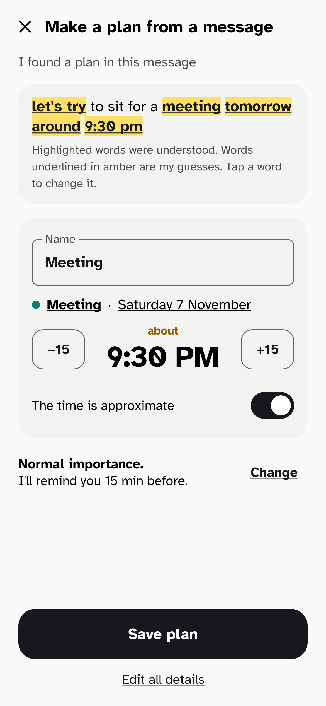
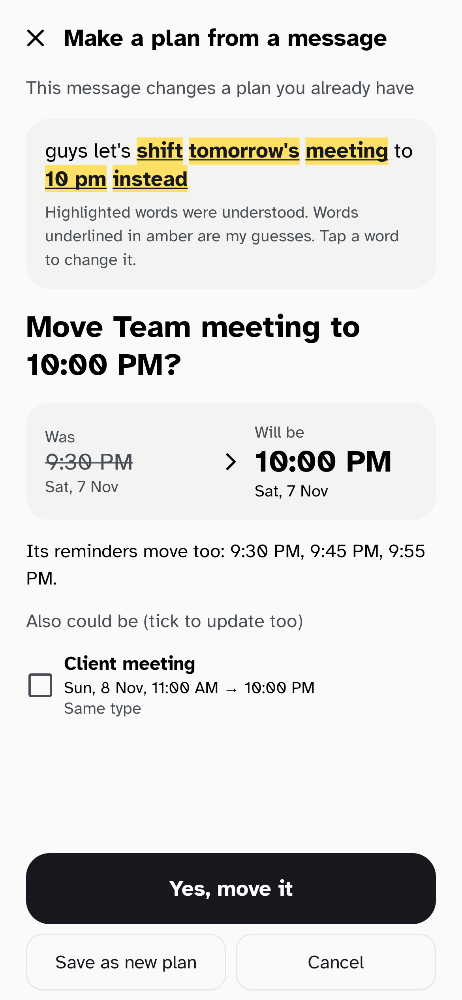
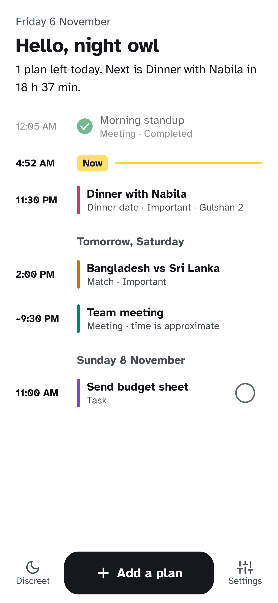
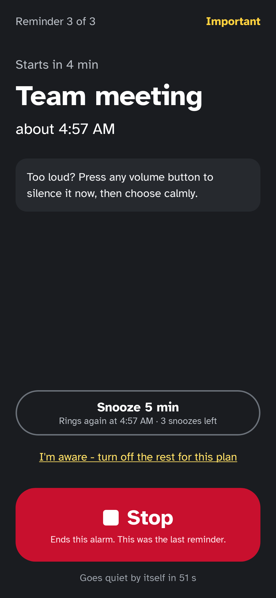

<div align="center">

# Kokhon

### Know When

**Turn any chat message or screenshot into a reminder in seconds.**

Paste it, share it, or screenshot it. Kokhon (কখন, "when") works out the *what*, *when* and *where*, then makes sure you don't forget.


</div>

---

## Highlights

| | Feature | Description |
|---|---|---|
| 📋 | **Paste & share capture** | Share *"let's sit for a meeting tomorrow around 9:30 pm"* from any chat app. You get a Meeting tomorrow at 9:30 PM. |
| 📸 | **Screenshot capture** | On-device text recognition reads chat screenshots and turns them into plans |
| 🖍️ | **Shows what it understood** | Understood words are marked like a highlighter pen. Tap any word to fix it. |
| 🎚️ | **Importance levels & reminder chains** | Kokhon suggests how important a plan is and a matching chain (e.g. 30, 15 and 5 min before). Accept it in one tap or change anything. |
| ⏰ | **Calm, clear alarms** | A big Stop button, a separate Snooze, a ring limit, "I'm aware - no more reminders", and a discreet vibrate-only mode |
| ✏️ | **Full control & updates** | Edit, rename, reschedule or delete anything. Share a changed message and Kokhon updates the existing plan. |
| 📅 | **Calendar, search & widget** | Month view, search across everything, a "Next up" home-screen widget and a Discreet Quick Settings tile |
| 🔒 | **Private by design** | Text recognition and parsing run on your phone. No account and no cloud needed. |

## Screenshots

| From a message | Updating a plan | Home timeline | Alarm |
|---|---|---|---|
|  |  |  |  |

Screenshots are rendered from the real UI by the test suite (`./gradlew :app:testDebugUnitTest`, output in `app/build/screenshots/`).

## Build & run

Requirements: JDK 21 and the Android SDK (platform 37). Android Studio installs both.

```bash
./gradlew assembleDebug        # build the debug APK -> app/build/outputs/apk/debug/
./gradlew installDebug         # install on a connected device or emulator
./gradlew test                 # unit tests
./gradlew spotlessApply lint   # format code and run Android Lint
```

Every push and pull request runs the same checks on GitHub Actions, and the debug APK is attached to each run.

## Project structure

```
app/                  Application, activity, screens
core/model/           Pure Kotlin domain: entries, importance, reminder chains, reminder planning
core/parser/          Pure Kotlin message parser and update matcher (English + Banglish), heavily tested
core/ocr/             On-device text recognition (ML Kit, bundled model) for screenshots and photos
core/data/            Room database (plans and their history) and settings (DataStore)
core/alarm/           Exact alarms, notifications, the ringing service and the alarm screen
core/designsystem/    Colours, typography, theme, icons and shared components
docs/                 Requirements, plan and design decisions
```

## Documentation

- [Requirement Analysis](docs/requirements-analysis.md): market scan, gaps, unique features, requirements, HCI principles
- [Development Plan & Architecture](docs/development-plan.md): tech stack, modules, roadmap, visual identity
- [Changelog](CHANGELOG.md)

## Roadmap

- [x] Requirement analysis & plan
- [x] Phase 0: Project foundation, design system & CI
- [x] Phase 1: Manual scheduling + reliable reminders & alarms
- [x] Phase 2: Text capture (paste / share) with smart parsing
- [x] Phase 3: Screenshot capture (on-device OCR)
- [x] Phase 4: Smart reminders, widgets, UX polish
- [ ] Phase 5: Release on Google Play

## Contributing

Bug reports and ideas are welcome. Please read [CONTRIBUTING.md](CONTRIBUTING.md) first.

## License & credit

**Copyright © 2026 Md. Mazid-Ul-Haque. All Rights Reserved.**

- ✅ Anyone may **install and use the official app** for personal use, free of charge.
- 👀 The source code is public **to view only**.
- ❌ Copying, modifying, redistributing or using the code commercially requires **written permission** from the author.

See [LICENSE](LICENSE) for the full terms. The bundled Atkinson Hyperlegible font is © Braille Institute of America, used under the [SIL Open Font License](third_party/atkinson-hyperlegible/OFL.txt).
